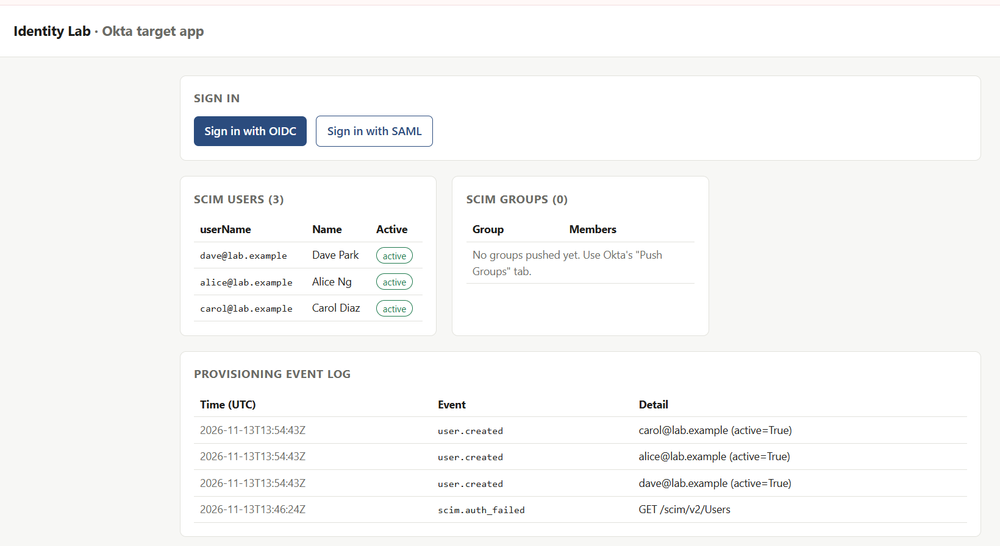
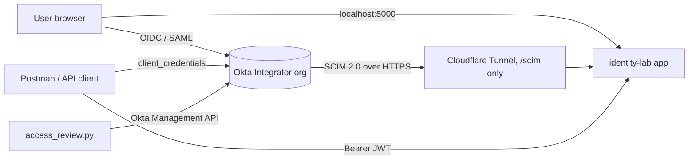

# identity-lab

A hands-on workforce identity lab: one target application wired to Okta for **OIDC**, **SAML**, **SCIM provisioning**,
**OAuth 2.0 API protection**, and a small **access review** (IGA) script. Built to understand how these flows behave
in practice, including what breaks and why.

<>

## What it covers

| Area | What's implemented | Where |
|---|---|---|
| Authentication (OIDC) | Authorization Code + PKCE, ID token validation, groups claim, RP-initiated logout, MFA via Okta authentication policy | `app/oidc.py` |
| Federation (SAML 2.0) | SP-initiated SSO, signed assertion validation, attribute + group mapping, SP metadata | `app/saml_sp.py` |
| Lifecycle (SCIM 2.0) | Users and Groups endpoints for Okta: create, filter, PUT/PATCH update, deactivate, group push, membership changes, event log | `app/scim.py` |
| API security (OAuth 2.0) | Client credentials flow, local JWT validation against JWKS (iss, aud, exp, scope), RFC 6750 error responses | `app/api.py`, `app/tokens.py` |
| Governance (IGA concepts) | Access review: collects assignments via Okta API, flags orphaned, dormant and separation-of-duties conflicts, outputs a certification CSV | `scripts/access_review.py` |
| Testing | 12 pytest cases replaying Okta's SCIM call shapes and bad-token cases; Postman collection for OAuth, Management API and SCIM | `tests/`, `postman/` |

## Architecture



## Run it

```bash
cp .env.example .env          # fill in as you go
docker compose up --build -d
open http://localhost:5000
# SCIM needs a public URL: named Cloudflare Tunnel (COMPOSE_PROFILES=named) or quick tunnel (quick)
```

No Docker? Run it in GitHub Codespaces: [docs/CODESPACES.md](docs/CODESPACES.md).

Full step-by-step setup: [docs/LAB-GUIDE.md](docs/LAB-GUIDE.md)

Tests (no Okta needed):
```bash
docker compose run --rm app pytest -q
docker compose run --rm app python scripts/access_review.py --demo
```

## What I learned

See [docs/troubleshooting-log.md](docs/troubleshooting-log.md) for real issues hit while building this and how they were resolved.

## Notes

- Lab code, not production: the SCIM store is a JSON file and the SCIM token is a static bearer token.
- No secrets in the repo. `.env` and `data/` are git-ignored.
